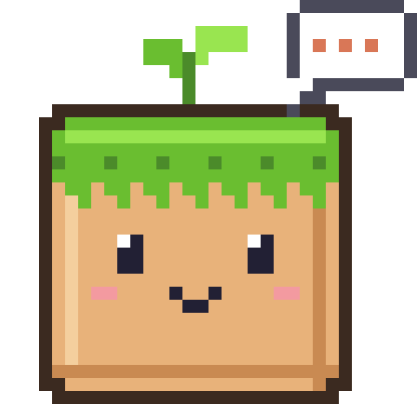

<p align="center">
  
</p>

<h1 align="center">Craft Companion</h1>

<p align="center">Talk to Claude from Minecraft chat. It knows your pack's real recipes, can look things up online,
and can tweak mod settings for you.</p>

> Unofficial fan project. Not affiliated with or endorsed by Anthropic or Mojang. "Claude" and "Claude Code" are trademarks of Anthropic.

## What it does
- **Chat:** `/claude <message>`. Claude sees your position, biome, held items (with their mod) and your recent chat,
  so "what's this?" and "what was that message?" just work.
- **Your pack's recipes:** the first time you ask in a world, the mod indexes every recipe the server sent, including
  modpack changes. Claude searches it instead of guessing.
- **Show recipe buttons:** answers about an item come with **[Show recipe]** / **[Show uses]** buttons that open EMI.
- **Web lookups:** wikis, guides, boss info.
- **Mod setting changes:** `/claude edit <what to change>`. Claude proposes changes to config files or datapacks;
  you click **[Apply]** or **[Discard]**. Originals are backed up and `/claude undo` restores them.

It runs [Claude Code](https://claude.com/claude-code) on your own PC with your own Claude account, using the fast,
low-usage Haiku model by default. Nothing goes through a third-party server.

## Requirements
- Minecraft **1.20.1** with **Fabric Loader** and **Fabric API**
- **Claude Code** installed and signed in on the same PC. It is included with the Claude desktop app,
  or install the CLI from claude.com/claude-code. Claude Code requires a Claude plan that includes it
  (Pro or Max) or an API key.
- Optional: **EMI** for the Show recipe buttons.
- Client side only. Works in single player and on any server; the server doesn't need it.

## Install
1. Download `craft-companion-<version>.jar` from the Releases page.
2. Put it in your instance's `mods` folder.
3. Launch the game, join a world and type `/claude hello`.

## Commands
| Command | What it does |
| --- | --- |
| `/claude <message>` | Ask Claude something |
| `/claude edit <change>` | Ask Claude to change a mod setting or datapack. Nothing changes until you Apply |
| `/claude apply` / `discard` | Apply or throw away the proposed changes (also clickable in chat) |
| `/claude undo` | Restore the files from before the last Apply |
| `/claude recipe <item id>` | Open EMI on how to make an item, e.g. `/claude recipe create:wrench` |
| `/claude uses <item id>` | Open EMI on what an item is used in |
| `/claude status` | Shows which Claude Code it found, settings, and when it will compact next |
| `/claude compact` | Shrink the conversation now to save usage |
| `/claude reset` | Start a new conversation (CLAUDE.md is kept) |

## How it remembers things
The mod keeps its files in a `craft-companion` folder in your instance:
- `CLAUDE.md`: Claude's lasting memory. Add your goals, base locations and play style under
  "Notes about the player". Read with every message and never overwritten.
- `instructions.md` and `mods.md`: how Claude should help, and your mod list. Rewritten every launch.
- `recipes/` and `items.txt`: the recipe and item index for the world you're in.
- `staged/` and `backups/`: proposed changes and backups for `/claude undo`.

The conversation carries on between messages and game sessions. Every 20 messages the mod runs Claude Code's
`/compact` in the background, which summarizes older messages so each new one uses less of your plan.

## Settings
`config/craftcompanion.json` (restart the game after editing):

| Setting | Default | Meaning |
| --- | --- | --- |
| `claudePath` | `""` | Full path to the Claude Code executable. Empty = find it automatically |
| `model` | `"haiku"` | Model alias: `haiku`, `sonnet` or `opus` |
| `compactEvery` | `20` | Compact after this many messages. `0` = never |
| `timeoutSeconds` | `180` | Give up on a reply after this long |
| `includeGameContext` | `true` | Send position, biome, held items, health, food, time and recent chat with each message |
| `allowWeb` | `true` | Let Claude search the web and read pages |
| `allowEdits` | `true` | Allow `/claude edit` |
| `allowApiKey` | `false` | `false` hides `ANTHROPIC_API_KEY` so your plan is used. `true` lets Claude Code bill your API key |

## Privacy and safety
- Your messages, the game info above and your last few chat lines are sent to Anthropic through Claude Code,
  under your own account.
- Claude can only **read and search** its own folder and your `config`, `defaultconfigs`, `datapacks` and `kubejs`
  folders, and use web search and fetch if `allowWeb` is on.
- It **can't** run commands, read the rest of your PC, or change any game file directly. In edit mode it may only
  write to `craft-companion/staged/`. Files change only when you click Apply, and the originals are backed up first.
- Your MCP servers and connectors are not loaded (`--strict-mcp-config`).

## Building from source
Needs JDK 17.
```bash
./gradlew build
```
The jar is written to `build/libs/`.

## License
MIT. See [LICENSE](LICENSE).
